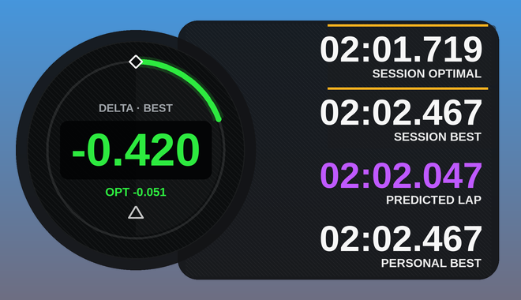

# Delta Reader

Live delta overlay for Assetto Corsa. It's a Custom Shaders Patch Lua app.

## What it does

- Live delta against your session best, session optimal, personal best or any saved lap. Click the gauge to switch between them.
- The smaller number under the delta shows the second reference: the optimal lap, or your best lap when the optimal is the main one.
- Session optimal is built from your best time through each of 40 mini-sectors.
- Predicted lap time is your reference lap plus your current delta. It shows purple if you're beating your PB, green if you're up on the reference and red if you're down.
- Every clean lap is saved per car and track. The app reads those laps back next time, so you have a reference from your first lap.

## Install

1. Download the repo as a zip (Code → Download ZIP), or grab the zip from Releases.
2. Drag it onto Content Manager and click Install.
   Or copy `apps/lua/DeltaReader` into `<Assetto Corsa>/apps/lua/`.
3. In game, turn it on from the app bar on the right.

You need [Custom Shaders Patch](https://acstuff.club/patch/).

## How it works

Each lap is stored as the lap time at 1,000 evenly spaced points around the track, based on the car's spline position. The live delta is your current lap time minus the reference time at the same point on track.

Laps are saved to `Documents/Assetto Corsa/DeltaReader/<car>@<track>/`. Each car and track has its own folder holding `pb.txt` and the last 30 valid laps.

Some laps aren't saved:
- out-laps
- laps with 3 or more wheels off track
- laps where you reverse or teleport

## Settings

Open settings from the cog on the app bar. You can change:
- the reference lap
- the arc range
- delta smoothing
- the track-limit rule
- whether the optimal lap uses all saved laps

## Limits

Assetto Corsa doesn't keep position data for old laps. Only laps driven with the app running can be used as references.
